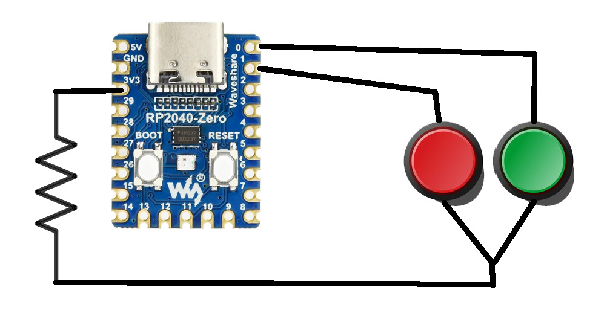

# CHCNAV フリスクスイッチで自動操舵ON/OFF（RP2040-Zero）

RP2040-Zeroを用いたCHCNAV自動操舵用のフリスクスイッチ（マウスエミュレーター）のプログラムとメモです。

- 使用マイコン: RP2040-Zero (CircuitPython)

## 関連動画（YouTube）

フリスクスイッチの作製手順およびアップデートに関する解説動画です。

### 1. フリスクスイッチで自動操舵ONOFF（作製・使用上の注意点）

> [動画を見る（YouTube）](https://youtu.be/2cvfJ65sIZ8)

### 2. フリスクスイッチで自動操舵ONOFF（CHCNAV 対応状況好転！）

> [動画を見る（YouTube）](https://youtu.be/OXriv8mp1M8)

## 必要なパーツ・リンク
- マルチコアボードモジュール RP2040-Zero
- 押しボタンスイッチ（キャップ付き）
- ユニバーサル基板
- はんだメッキ線 0.6mm

- ## 回路図・配線について

RP2040-Zeroとタクトスイッチ（赤・緑）の配線図です。

- **使用マイコン**: Waveshare RP2040-Zero[cite: 1]
- **ピン割り当て**:
  - スイッチ1（緑）: `GP0`[cite: 1]
  - スイッチ2（赤）: `GP1`[cite: 1]
  - 抵抗を経由した電源ライン接続（3V3ピン周辺）[cite: 1]

## 参考リンク
- [CircuitPython ファームウェア](https://circuitpython.org/board/raspberry_pi_pico/)
- [Adafruit HID ライブラリ](https://docs.circuitpython.org/projects/hid/en/latest/)
- [Mu Editor](https://codewith.mu/en/download)
